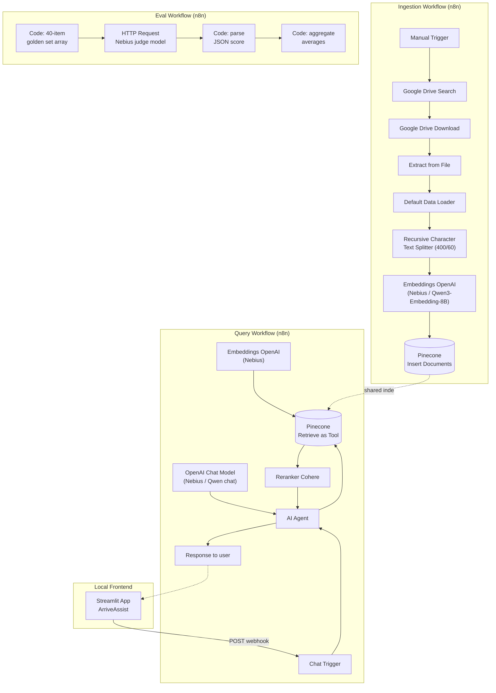

# ArriveAssist — Solution Kit

## 1. Solution Summary

ArriveAssist is a retrieval-augmented generation (RAG) system that answers
questions about Canadian citizenship, OHIP (Ontario health coverage), and
SIN (Social Insurance Number) applications, grounded in official
government sources. It refuses to answer outside these three topics and
refuses rather than guesses when its source documents don't cover
something.

The system has four parts, built and orchestrated separately:

1. **Ingestion pipeline** (n8n) — loads source PDFs, chunks and embeds
   them, stores them in Pinecone
2. **Query pipeline** (n8n) — receives a question, retrieves and reranks
   relevant chunks, generates a grounded answer
3. **Eval pipeline** (n8n) — scores a 40-question golden set for
   correctness and faithfulness using an LLM judge
4. **Frontend** (Streamlit, local) — a chat UI that talks to the query
   pipeline over a webhook

---

## 2. Architecture Diagram



---

## 3. Node Roster

| Workflow | Node | Type | Role |
|---|---|---|---|
| Ingestion | Manual Trigger | Trigger | Starts ingestion on demand |
| Ingestion | Google Drive Search | Google Drive | Lists PDFs in a topic subfolder |
| Ingestion | Google Drive Download | Google Drive | Downloads each PDF's binary content |
| Ingestion | Extract from File | File | Extracts plain text from each PDF |
| Ingestion | Default Data Loader | LangChain sub-node | Prepares text + metadata (source filename) for chunking |
| Ingestion | Recursive Character Text Splitter | LangChain sub-node | Splits text into 400-char chunks, 60-char (15%) overlap |
| Ingestion | Embeddings OpenAI (Nebius) | LangChain sub-node | Generates vectors via Qwen3-Embedding-8B |
| Ingestion | Pinecone Vector Store (Insert) | Root node | Writes chunks + vectors + metadata into the index |
| Query | Chat Trigger | Trigger | Exposes a webhook + built-in test chat window |
| Query | AI Agent | Root node | Orchestrates tool calls and generates the final answer |
| Query | OpenAI Chat Model (Nebius) | LangChain sub-node | The generation model behind the AI Agent |
| Query | Pinecone Vector Store (Retrieve as Tool) | LangChain sub-node | Retrieval tool available to the AI Agent |
| Query | Embeddings OpenAI (Nebius) | LangChain sub-node | Embeds the incoming question for retrieval |
| Query | Reranker Cohere | LangChain sub-node | Reorders retrieved candidates by relevance |
| Eval | Code (golden set array) | Code | Holds the 40 question/expected/actual/source records |
| Eval | HTTP Request (judge) | HTTP Request | Sends each record to Nebius for LLM-judge scoring |
| Eval | Code (parse) | Code | Extracts the JSON score from each judge response |
| Eval | Code (aggregate) | Code | Averages correctness/faithfulness across all 40 |

---

## 4. Node Deep Dives

**Default Data Loader + Recursive Character Text Splitter**
Chunk size 400 characters, 15% (60-char) overlap. Chosen over
sentence-based or semantic chunking because the source pages are short,
list-heavy government content — a recursive splitter respects
paragraph/sentence boundaries where possible and falls back to a fixed
size, without the extra cost of a semantic-chunking pass.

**Pinecone Vector Store — Insert mode**
Index config: dimension 4096 (matching Qwen3-Embedding-8B's native
output), metric cosine, dense vector type. Dense-only, since hybrid
(dense + sparse) retrieval wasn't in scope for this build — noted as a
future improvement.

**Pinecone Vector Store — Retrieve as Tool mode**
Top-k set to 20 candidates before reranking (widened from an initial 4,
to give the reranker a meaningful pool to work with rather than reranking
an already-narrow shortlist).

**Reranker Cohere**
Re-scores the top-20 candidates for relevance; n8n currently returns only
the top 3 reranked results regardless of configuration — a known,
documented n8n platform limitation, not a configuration error.

**AI Agent**
Holds the system message (see Prompt Library) and is the single point
that decides whether to call the retrieval tool, how to phrase refusals,
and when to include a source citation.

**HTTP Request (eval judge)**
Calls the same Nebius chat endpoint used for generation, but with a
separate, dedicated scoring system prompt — reusing existing
infrastructure and credentials rather than adding a new eval-specific
tool.

---

## 5. Prompt Library

### AI Agent — System Message

```
You are a settlement assistant helping newcomers to Ontario, Canada with practical questions about Canadian citizenship, Ontario health coverage (OHIP), and the Social Insurance Number (SIN).

Rules:
1. Answer only using information returned by the knowledge base tool. Never use your own general knowledge, even if you believe you know the answer.
2. Always call the knowledge base tool before answering any factual question — even ones that seem simple or obvious.
3. If the tool does not return information relevant to the question, say clearly: "I don't have that information in my documents." Do not guess or generalize.
4. When you answer using retrieved information, check the source field in the retrieved metadata. Only include a source line if that value is a genuine, well-formed HTTP or HTTPS link. If the source is missing, empty, or not an actual URL, omit the source line entirely.
5. If a question is outside citizenship, OHIP, or SIN, say plainly that it's outside what you can help with. Do not attempt to answer it anyway.
6. If a question spans more than one topic, retrieve and use information from all relevant topics, and cite every source used.
7. Keep answers concise and practical — the person is trying to complete a real task, not read an essay.
8. When refusing an out-of-scope question, do not include specific URLs or website links from your own knowledge. You may name the general resource without a link, or say the person should search for it directly.
```

### Pinecone Tool — Description

```
Searches an indexed knowledge base of official Government of Canada and Government of Ontario pages covering three topics: Canadian citizenship (eligibility, application process), Ontario Health Insurance Plan / OHIP (eligibility, coverage, how to apply), and Social Insurance Number / SIN (application, required documents, processing status). Use this tool for any question touching these topics before composing an answer.
```

### Eval Judge — System Message

```
You are an evaluation judge for a RAG system. You will be given a question, an expected answer (ground truth), the bot's actual answer, and the source the bot cited (if any). Score the actual answer on two dimensions:

1. CORRECTNESS (0-1): Does the actual answer convey the same factual content as the expected answer? 1 = fully correct, 0.5 = partially correct or missing nuance, 0 = wrong or contradicts the expected answer.

2. FAITHFULNESS (0-1): Is the answer grounded and honest, with no fabricated details? Score 0 if the cited source is not real/consistent, or a URL is invented. Score 1 if grounded, or an honest refusal on a known-gap question.

Special rule: on a "known gap" question, a refusal scores 1 on both dimensions. A confident, unsupported answer scores 0 on faithfulness regardless of whether it happens to be plausible.

Return ONLY valid JSON: {"correctness": 0-1, "faithfulness": 0-1, "note": "one short sentence"}
```

### Query Parameters (reference)

| Parameter | Value |
|---|---|
| Chunk size / overlap | 400 chars / 60 chars (15%) |
| Embedding model | Qwen/Qwen3-Embedding-8B |
| Index dimension / metric | 4096 / cosine |
| Retrieval top-k (pre-rerank) | 20 |
| Reranked results returned | 3 (n8n platform limit) |
| Generation model | Qwen chat model (Nebius) |

---

## 6. Integration Layer

**n8n** — the orchestration layer for all three pipelines (ingestion,
query, eval). No custom backend code; all logic lives in connected nodes.

**Nebius (Token Factory)** — used in two distinct roles, both via the same
OpenAI-compatible credential:
- *Embeddings*: Qwen3-Embedding-8B, used identically at ingestion time
  (document chunks) and query time (the incoming question), so both sides
  of every similarity comparison live in the same vector space.
- *Generation*: a separate Qwen chat model, used both for the AI Agent's
  final answers and for the eval judge's scoring calls.

**Pinecone** — the vector database. One index (`citizenship-rag`, despite
the name, holds all three topics) stores every chunk's embedding plus
metadata (source filename). Used for both insert (ingestion) and retrieve
(query) operations against the same index.

**Cohere** — used exclusively for reranking, plugged into Pinecone's
retrieve step in the query workflow. Not used anywhere in ingestion.

**Google Drive** — source-of-truth storage for the ingested PDFs,
organized into per-topic subfolders, read by the ingestion workflow only.

---

## 7. Eval Loop

1. **Golden set**: 40 hand-curated questions spanning straightforward
   lookups, ambiguous phrasing, cross-topic questions, and deliberate
   out-of-scope refusals — each with a written expected answer (including
   explicit "known gap" markers where the source documents genuinely don't
   cover something).
2. **Data collection**: each question run through the live Chat Trigger;
   question, actual answer, and cited source captured.
3. **Judge scoring**: all 40 records sent through a dedicated eval
   workflow — a Code node holding the array, an HTTP Request node calling
   Nebius with the judge system message, per-item.
4. **Parsing**: a Code node (Run Once for Each Item) extracts the
   `{correctness, faithfulness, note}` JSON from each judge response.
5. **Aggregation**: a final Code node (Run Once for All Items) averages
   both scores across all 40 questions.

**Result**: 95% average correctness, 95% average faithfulness across the
40-question golden set.

This loop is rerunnable — swap in updated actual answers after any
pipeline change (new chunking, new prompt, hybrid retrieval, etc.) and
re-run steps 3–5 to get an updated score without re-authoring the golden
set.

---

## 8. Local Streamlit Environment

The frontend (**ArriveAssist**) runs entirely locally in VS Code, separate
from n8n:

- Landing page: app name, tagline, and an explicit Do's/Don'ts section
  matching the AI Agent's actual scope rules
- Chat interface: sidebar with new-chat and chat-history-thread switching,
  main panel with standard chat bubble UI
- Connects to the query workflow via a plain HTTP POST to the n8n Chat
  Trigger's **activated** (production) webhook URL — no embedding of n8n
  itself, no shared hosting; the two run independently and only talk over
  that one HTTP call
- Local-only by design for this build: `pip install -r requirements.txt`
  then `streamlit run` — no deployment step required to demo it

